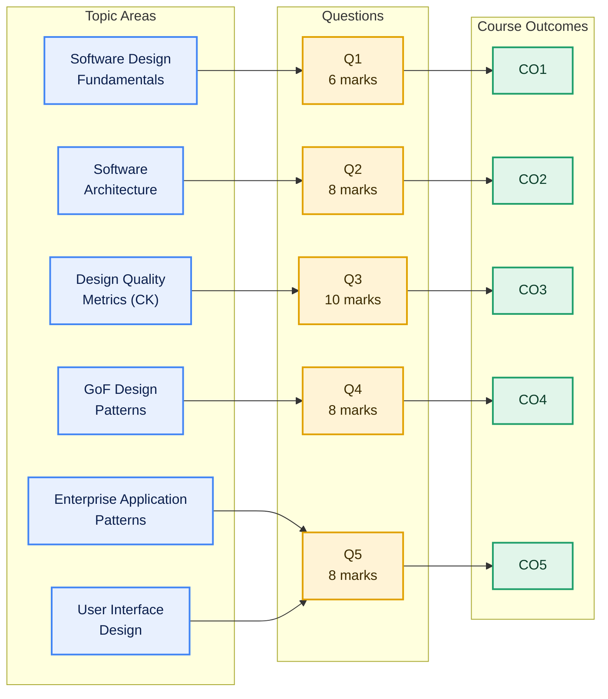
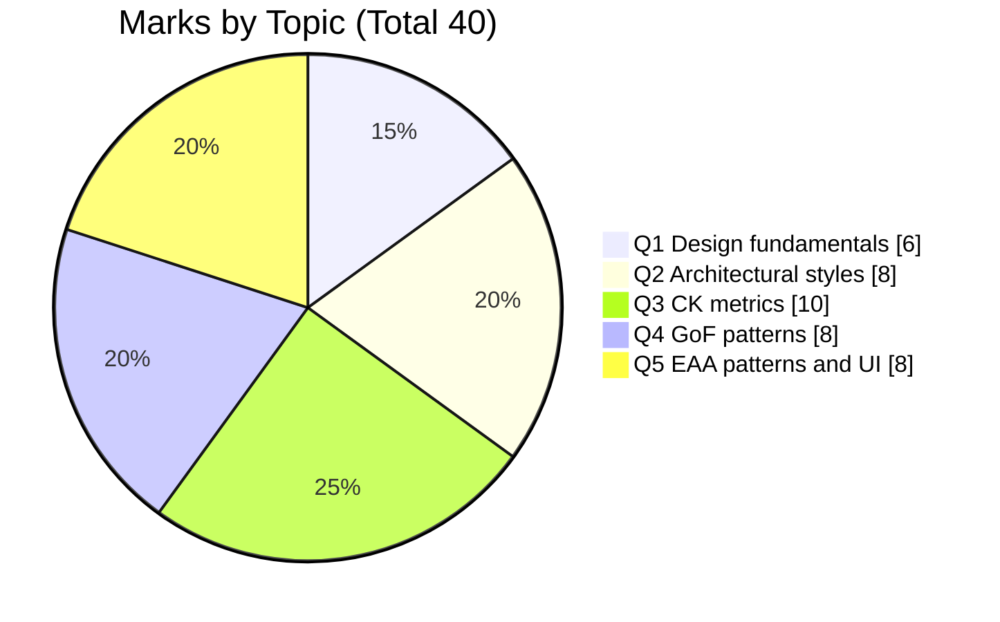

<div align="center">

# 📘 Software Design — OBE Question Paper

### Outcome-Based Education · Bloom's Taxonomy · BNQF (Bachelor, Level 6)


**Md Jahidul Islam** · ID: `IT24018`
Mawlana Bhashani Science and Technology University

</div>

---

## 📑 Table of Contents

1. [Overview](#-overview)
2. [Exam Information](#-exam-information)
3. [Course Outcomes (CO)](#-course-outcomes-co)
4. [Bloom's Taxonomy and BNQF Alignment](#-blooms-taxonomy-and-bnqf-alignment)
5. [Question Paper](#-question-paper)
6. [Topic → Question → CO Map](#-topic--question--co-map)
7. [Question–CO Mapping](#-questionco-mapping-obe-summary)
8. [Marks Distribution](#-marks-distribution)
9. [Marking Rubric](#-marking-rubric)

---

## 🎯 Overview

This repository contains an **Outcome-Based Education (OBE)** question paper for the **Software Design** part of the Software Engineering course.

Every question is:

- ✅ mapped to exactly one **Course Outcome (CO)**
- ✅ tagged with its **Bloom's Taxonomy** level
- ✅ classified under a **BNQF** learning domain
- ✅ given a clear mark allocation, so the total is exactly **40**

The paper progresses from **recalling** design fundamentals to **evaluating** enterprise patterns and UI design.

---

## 📝 Exam Information

| Item | Detail |
|------|--------|
| Course | Software Engineering |
| Part | Software Design |
| Qualification Level | BNQF Bachelor, Level 6 |
| Full Marks | 40 |
| Time | 1 Hour |
| Instruction | Answer **ALL** questions. Marks are shown in brackets `[ ]`. |

---

## 🎓 Course Outcomes (CO)

Upon completion of the course, students will be able to:

| CO | Outcome | Level |
|----|---------|-------|
| **CO1** | Explain the fundamental principles of software design: modularity, coupling, cohesion, abstraction and information hiding. | Knowledge / Understanding |
| **CO2** | Describe and distinguish software architectural styles and their suitable use. | Understanding |
| **CO3** | Apply object-oriented design quality metrics (CK metrics suite) to assess a design. | Cognitive (Apply, Analyze) |
| **CO4** | Apply GoF design patterns to solve common object-oriented design problems. | Cognitive (Apply, Create) |
| **CO5** | Analyze and evaluate enterprise application patterns and user interface design principles. | Cognitive (Analyze, Evaluate) |

---

## 🧠 Bloom's Taxonomy and BNQF Alignment

| Bloom Level | Code | Typical Verbs | Used In |
|-------------|------|---------------|---------|
| Remember | C1 | Define, State, List | Q1 |
| Understand | C2 | Explain, Describe, Differentiate | Q2 |
| Apply | C3 | Calculate, Write, Implement | Q3, Q4 |
| Analyze | C4 | Compare, Comment, Identify | Q3, Q5 |
| Evaluate | C5 | Justify, Recommend | Q5 |
| Create | C6 | Design, Propose, Construct | Q4 |


---

## 📄 Question Paper

### Question 1 — Design Fundamentals `[6 Marks]`

> **Bloom:** Remember (C1) · **BNQF Domain:** Knowledge · **CO:** CO1

- **(a)** Define software design. Differentiate between architectural design and detailed design. `[2]`
- **(b)** Define coupling and cohesion. State which one should be low and which one should be high in a good design. `[2]`
- **(c)** Define abstraction and information hiding (encapsulation). `[2]`

---

### Question 2 — Architectural Styles `[8 Marks]`

> **Bloom:** Understand (C2) · **BNQF Domain:** Understanding · **CO:** CO2

Explain any **FOUR** of the following architectural styles. For each style, describe its main components and how they interact, and give one suitable application example. `[8]`

- Layered
- Event-based
- Model-View-Controller (MVC)
- Blackboard / Repository
- Pipes and Filters

---

### Question 3 — Design Quality Metrics `[10 Marks]`

> **Bloom:** Apply (C3), Analyze (C4) · **BNQF Domain:** Cognitive · **CO:** CO3

Consider the following Java class (ignore the constructor and standard API calls such as `System.out`):

```java
class Order {
  private double total;
  private int count;
  private Payment p;
  private Logger l;

  public void addItem(double price) { total += price; count++; }
  public double getTotal() { return total; }
  public int getCount() { return count; }
  public void pay() {
    if (p != null) { p.process(); l.log("paid"); }
    else { l.log("no payment"); }
  }
}
```

- **(a)** Calculate **CBO** (Coupling Between Object classes) of `Order`. `[1]`
- **(b)** Calculate **LCOM = |P| − |Q|** by listing all method pairs. `[2]`
- **(c)** Calculate **LCOM2 = 1 − Σ(m·aᵢ)/(m·a)**, showing `m`, `a` and the usage count of each attribute. `[2]`
- **(d)** Calculate **WMC** using McCabe complexity (number of conditions + 1) for each method. `[2]`
- **(e)** Calculate **RFC** (Response For a Class) of `Order`. `[1]`
- **(f)** Based on your results, comment on the cohesion of the class and suggest one refactoring to improve it. `[2]`

---

### Question 4 — Applying Design Patterns `[8 Marks]`

> **Bloom:** Apply (C3), Create (C6) · **BNQF Domain:** Cognitive · **CO:** CO4

A `NotificationService` class sends alerts to users. Currently it uses a long `if-else` chain on a string type (`"EMAIL"`, `"SMS"`, `"PUSH"`) to choose how to send the message. New channels (e.g., WhatsApp) must be added frequently, and the channel must be changeable at runtime.

- **(a)** Identify the most suitable GoF pattern for this problem and justify your choice. `[2]`
- **(b)** Write a Java skeleton (interface, two concrete classes, and the context class with a setter) that applies the pattern. Name each class according to its role in the pattern. `[4]`
- **(c)** State two benefits and one liability of applying this pattern here. `[2]`

---

### Question 5 — Enterprise Patterns and UI Design `[8 Marks]`

> **Bloom:** Analyze (C4), Evaluate (C5) · **BNQF Domain:** Cognitive · **CO:** CO5

An online hospital appointment system has patients, doctors and admins. The `Doctor` class has subclasses `GeneralPractitioner` and `Specialist`. The system has complex page navigation and role-based access.

- **(a)** Compare **Page Controller** and **Front Controller**. Which one is more appropriate for this system? Justify your answer. `[3]`
- **(b)** Compare **Single Table**, **Class Table** and **Concrete Table** Inheritance for mapping the `Doctor` hierarchy to a database. Recommend one with justification. `[3]`
- **(c)** The appointment screen shows slot availability using only red (booked) and green (free). Identify the UI design principle violated and propose two improvements. `[2]`

---

## 🔀 Topic → Question → CO Map

The diagram below shows which topic area each question comes from, and which CO it assesses.



---

## 🗺️ Question–CO Mapping (OBE Summary)

| Q | CO | Bloom's Level | BNQF Domain | Topic | Marks |
|:-:|:--:|---------------|-------------|-------|:-----:|
| 1 | CO1 | Remember (C1) | Knowledge | Design fundamentals | 6 |
| 2 | CO2 | Understand (C2) | Understanding | Architectural styles | 8 |
| 3 | CO3 | Apply (C3), Analyze (C4) | Cognitive | CK metrics | 10 |
| 4 | CO4 | Apply (C3), Create (C6) | Cognitive | GoF patterns | 8 |
| 5 | CO5 | Analyze (C4), Evaluate (C5) | Cognitive | EAA patterns, UI | 8 |
| | | | | **Total** | **40** |

**CO coverage matrix**

| | Q1 | Q2 | Q3 | Q4 | Q5 |
|---|:-:|:-:|:-:|:-:|:-:|
| CO1 | ✔ | | | | |
| CO2 | | ✔ | | | |
| CO3 | | | ✔ | | |
| CO4 | | | | ✔ | |
| CO5 | | | | | ✔ |

---

## 📊 Marks Distribution



| Cognitive Group | Questions | Marks | Share |
|-----------------|-----------|:-----:|:-----:|
| Lower-order (C1–C2) | Q1, Q2 | 14 | 35% |
| Higher-order (C3–C6) | Q3, Q4, Q5 | 26 | 65% |

---

## 🧾 Marking Rubric

| Question | Criteria | Marks |
|----------|----------|:-----:|
| Q1 | Correct definitions and clear differences | 6 |
| Q2 | Four styles × (components + interaction + example) | 8 |
| Q3 | Correct metric values with shown working; sound comment and refactoring | 10 |
| Q4 | Correct pattern with justification; role-based class names; benefits and liability | 8 |
| Q5 | Fair comparison with reasoned recommendation; correct UI principle and improvements | 8 |

---

<div align="center">

**Prepared by Md Jahidul Islam (IT24018)** · Software Engineering · OBE Assignment

</div>
